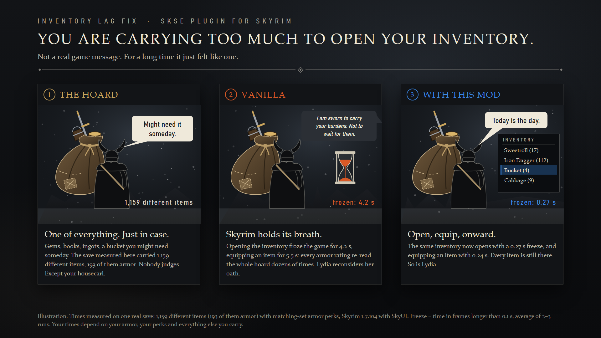
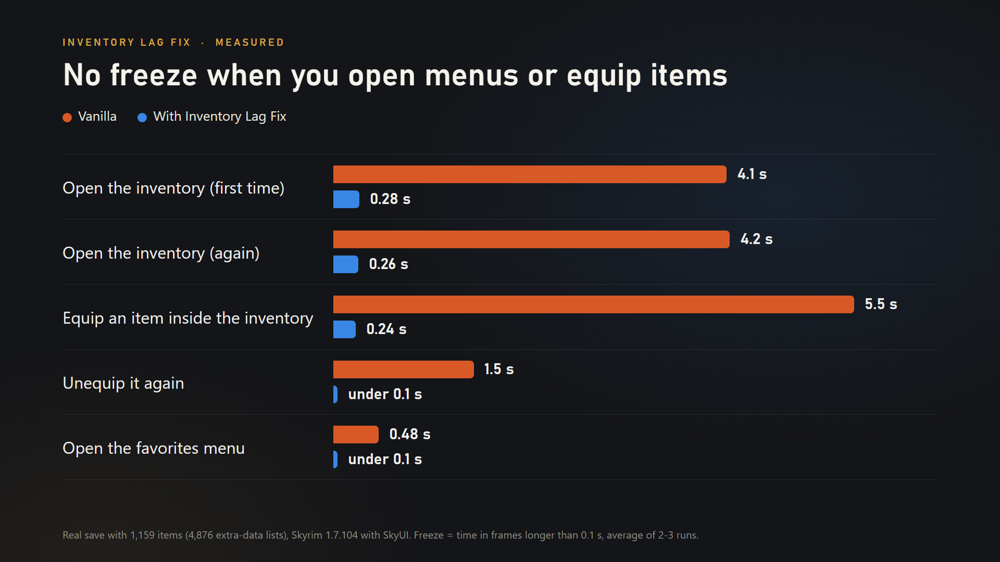

# Inventory Lag Fix

An SKSE plugin for Skyrim Special Edition / Anniversary Edition (1.5.97, 1.6.x and 1.7.x). If you carry
a lot of items, opening the inventory freezes the game for seconds, and the freeze grows quickly with
every item you pick up. This plugin removes that freeze. It also covers the other item screens
(containers, shops, gifting, the favorites menu), the list refresh after you equip something inside
the inventory, and crafting menus with very large recipe lists.

It is worst with armor perks that check what you are wearing (Matching Set, Well Fitted, Custom Fit and
similar perks from the DLCs, the Unofficial Patch or perk overhauls), and with SkyUI. If your inventory
already opens without a noticeable pause, there is little for this plugin to remove. Menu lag from other
causes, such as icon mods or scripts, is not something it touches.

No ESP, no scripts, nothing is written to your save. You can add or remove it at any time.

## Results

Measured on a real save with 1,159 items (4,876 extra-data lists), Skyrim 1.7.104 with SkyUI.
"Frozen" is the time the game spends in frames longer than 0.1 s.

| | Vanilla | With Inventory Lag Fix |
|---|---|---|
| Open the inventory (first time) | 4.1 s | 0.28 s |
| Open the inventory (again) | 4.2 s | 0.26 s |
| Equip an item inside the inventory | 5.5 s | 0.24 s |
| Unequip it again | 1.5 s | under 0.1 s |
| Open the favorites menu | 0.48 s | under 0.1 s |

The same save trimmed to fewer items (time frozen while the inventory opens, average of 2 opens):

| Items | 44 | 110 | 256 | 405 | 605 | 802 | 1,002 | 1,159 |
|---|---|---|---|---|---|---|---|---|
| Vanilla | 0 | 0 | 0.29 s | 0.56 s | 1.19 s | 2.03 s | 3.14 s | 4.16 s |
| With Inventory Lag Fix | 0 | 0 | 0 | 0 | 0 | 0 | 0.17 s | 0.27 s |

The vanilla freeze grows much faster than the item count; with this plugin it stays small.

### Special Edition 1.5.97

Measured on 1.5.97 without other mods (vanilla UI), with 1,142 items added from the console. Time frozen
while the screen opens, 3 opens each:

| | Vanilla | With Inventory Lag Fix |
|---|---|---|
| Inventory | 0.15–0.16 s | 0 |
| Container | 0.15–0.16 s | 0 |
| Shop | 0.17–0.19 s | 0 |

This is a different setup from the 1.7.104 save above, so the two sets of numbers are not a comparison
between game versions.

### Crafting menus

With SkyUI, a crafting menu asks for the armor rating of every armor recipe in its list. Measured on the
1.7.104 save above with the forge's list grown to 10,000 armor recipes (the save's own 729 forge recipes
plus copies made in memory for the test; 7,759 shown), 2 opens each:

| | 1.1.0 | 1.2.0 |
|---|---|---|
| Time frozen while the forge opens | 1.31 s | 0.65–0.67 s |
| Until the menu appears | 0.81–0.83 s | 0.21–0.22 s |

Most of what remains is SkyUI building its list, which a plugin cannot change. With the save's own
729 forge recipes the forge opened without a freeze in both versions, so this matters only for very
large recipe lists (many armor mods). Weapon recipes and the cooking pot hardly ask for armor ratings.

## Cause

This was found by profiling and reverse engineering `SkyrimSE.exe` 1.7.104. Three places in the game read
the whole inventory again and again, taking a lock for every extra-data list:

1. **Armor perk conditions.** To show an armor rating, `PlayerCharacter::GetArmorValue` (Address Library
   ID 40249) runs every "Mod Armor Rating" perk entry. Conditions such as `WornApparelHasKeywordCount` and
   `WornHasKeyword` call `InventoryChanges::VisitWornItems` (ID 16096), which finds the worn items by
   walking the entire inventory. Matching-set and fitted-armor perks (vanilla, Dawnguard, Dragonborn, the
   Unofficial Patch, Creation Club armor sets) carry dozens of such conditions, so one armor rating costs
   dozens of full inventory scans.
2. **Worn armor per body slot.** For every item card the game collects the armor worn in each of the 32
   body slots (ID 51826) and calls the worn-entry lookup (ID 16091) once per occupied slot. Each lookup
   walks the whole inventory again.
3. **Building the item list.** Menus build their list by asking `InventoryChanges::GetInventoryItemAt`
   (ID 16106) for row 0, 1, 2, ... until it returns nothing, and each call counts from the first item
   again. A list of N rows costs N x N item visits.

In crafting menus with SkyUI, the armor rating of item 1 is asked for once per recipe in the list, so a
list of N armor recipes costs N more full scans.

The IDs above are Anniversary Edition IDs. 1.5.97 has the same functions under its own IDs (for example
15866 for `GetInventoryItemAt`).

## How it is fixed

The game's own code still does all the work. The plugin only skips work that is repeated without
anything changing in between:

1. Inside one `GetArmorValue` call the worn items cannot change. The first `VisitWornItems` call records
   the entries the game visits, and the later calls in the same `GetArmorValue` call replay that list to
   the visitor (same entries, same order, same early-stop rule). While a crafting menu rebuilds its
   recipe list (AE ID 51401, SE ID 50510), the recorded list is kept for all the armor ratings of that
   rebuild and dropped when it returns; the rebuild only reads the inventory.
2. Inside one call of 51826, the worn-entry lookup runs on a list made of only the entries that have a
   worn (or worn-left) extra-data list, in their original order. Other entries can never be returned,
   and the only change the lookup can make (un-wearing a leveled item with a negative count) does nothing
   to an entry without a worn list.
3. For the item-list builders of the inventory, container, barter, gift and favorites menus, the next call
   to `GetInventoryItemAt` continues its walk at the item that produced the previous row, with the row
   counter set to that item's first row. Rows from the base container (which come first) are produced by
   the unchanged code; once the position is known, that part is skipped because all its rows lie before
   the requested one. This uses two small jumps inside the function. On 1.5.97 the function keeps its
   walk state in other places, so the two jumps have 1.5.97 variants there; 1.5.97 has five of the seven
   builders.

Every cache lives for one call (or one list build, or one recipe-list rebuild) on one thread and is
dropped afterwards. Each thread keeps its own. All other calls run the original code unchanged.

## Verified against the original code

`bVerify=1` runs the original code next to every cached call and compares the results. Each release was
checked this way:

| | Armor values | Replayed worn-item lists | Slot lookups | List rows | Differences |
|---|---|---|---|---|---|
| 1.0.0 on 1.7.104 (the save above) | 17,743 | 145,750 | 16,608 | 6,249 | 0 |
| 1.1.0 on 1.7.104 (the save above) | 22,090 | 151,262 | 21,264 | 9,476 | 0 |
| 1.1.0 on 1.5.97 (the test setup above) | 3,433 | 121,758 | 37 | 8,011 | 0 |
| 1.2.0 on 1.7.104 (the save above, forge with 10,000 recipes) | 10,276 | 462,082 | 1,928 | 2,332 | 0 |
| 1.2.0 on 1.6.1170 (test setup with SkyUI, forge with 10,000 recipes) | 20,020 | 811,522 | 9,198 | 2,284 | 0 |
| 1.2.0 on 1.5.97 (test setup with SkyUI, forge with 10,000 recipes) | 7,740 | 286,792 | 28 | – | 0 |

1.0.0 and 1.2.0 were also checked with Inventory Refresh Fix loaded at the same time (1.2.0 on 1.7.104),
and 1.2.0 with SkyUI Inventory Optimizer (1.5.97 with SkyUI).

## Safety

- Nothing is patched unless every Address Library ID resolves and each hooked function (and the two
  jump points inside `GetInventoryItemAt`) matches the expected machine code. Each of the three fixes is
  installed only as a whole.
- If another plugin already patched one of these places, that fix is skipped and the log says so. A
  plugin that patches the same place later, or replaces the whole function, can undo a fix without the
  log showing it.
- The result is written to `Documents\My Games\Skyrim Special Edition\SKSE\InventoryLagFix.log`.

## If it doesn't seem to help

Check the log first. If you report it (a GitHub issue or a comment on the Nexus Mods page), please include
your game, SKSE and Address Library versions, the log, and your list of SKSE plugins (`skse64.log` in the
same folder). The pinned comment on the Nexus Mods page has the details.

## Settings

`Data\SKSE\Plugins\InventoryLagFix.ini`:

| key | default | meaning |
|---|---|---|
| `bEnabled` | 1 | 0 = install nothing |
| `bFixArmorPerkConditions` | 1 | fix 1 |
| `bFixWornSlotLookup` | 1 | fix 2 |
| `bFixItemListLookup` | 1 | fix 3 |
| `bLogStats` | 0 | 1 = write cache counters to the log every few seconds |
| `bVerify` | 0 | 1 = testing only: also run the original code and log any difference (much slower) |

## Requirements

- [SKSE64](https://skse.silverlock.org/) for your game version (2.0.20 for 1.5.97)
- [Address Library for SKSE Plugins](https://www.nexusmods.com/skyrimspecialedition/mods/32444): "All in one
  (Anniversary Edition)" for 1.6.x / 1.7.x, "All in one (Special Edition)" for 1.5.97

## Compatibility

- Built and tested on Skyrim **1.7.104** and **1.6.1170** (Anniversary Edition) and **1.5.97** (Special
  Edition). On other versions every fix first checks the game code and turns itself off if it does not
  match; check the log to see what was installed. Tested with SKSE 2.3.1 (1.7.104), 2.2.6 (1.6.1170) and
  2.0.20 (1.5.97).
- Tested with SkyUI on all three, and with the vanilla UI on 1.5.97.
- Inventory Refresh Fix and SkyUI Inventory Optimizer can stay installed. Each was run together with this
  plugin (Inventory Refresh Fix on 1.7.104, SkyUI Inventory Optimizer on 1.5.97 with SkyUI) and the verify
  mode found no differences. They target other parts of the freeze; only the item-list fix overlaps with
  Inventory Refresh Fix.
- On the 1.7.104 save, adding Inventory Refresh Fix on top of this plugin did not change the times, except
  for the first inventory open after starting the game: Inventory Refresh Fix checks its own results once
  per session, which took about 0.5 s with or without this plugin (0.77 s instead of 0.30 s).
- Skyrim VR: not supported for now. I don't own it, so I can't build or test for it. If I get it later,
  I'll look into it.

## Changes

- **1.2.0**: Crafting menus with very large recipe lists: the armor rating of each recipe no longer
  scans the whole inventory again (with SkyUI; about half the freeze at 10,000 armor recipes). Tested on
  1.7.104, 1.6.1170 and 1.5.97.
- **1.1.0**: Special Edition 1.5.97 support. Nothing changes on Anniversary Edition (1.6.x / 1.7.x), so
  there is no need to update there.
- **1.0.0**: First release.

## Building

`build.bat` (Visual Studio 2022 or Build Tools 2022, x64). Output: `build\InventoryLagFix.dll`, also copied
to `package\SKSE\Plugins\`.

## Support

All my mods are free. If this one made your game better and you'd like to say thanks, you can [buy me a coffee](https://buymeacoffee.com/quoteproxy). There are no paid perks or early access.

## License

MIT
